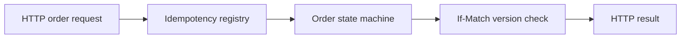

# Architecture and engineering decisions

> **Scope:** a local reference implementation using invented/synthetic inputs. No production deployment or service-level claims are implied.

## Java 21 order API with concurrency semantics

**Actual processing path:** HTTP create --> Idempotency key registry --> Order state machine --> If-Match version guard --> Read or 409 conflict.

## Key files

- `src/main/java/dev/swaraj/keyline/OrderService.java`: domain invariants, duplicate request handling and versions.
- `src/main/java/dev/swaraj/keyline/Server.java`: Java HTTP endpoints and JSON responses.
- `src/test/java/dev/swaraj/keyline/SmokeTest.java`: endpoint and state tests.

## Failure modes / trust boundaries

Data is process-local and disappears on restart. No authentication, durable storage, TLS termination or multi-node consistency. Bind locally when experimenting.

## What I would build next

PostgreSQL-backed transactions, OpenAPI, auth, request tracing, load and race tests.

## Reviewer checklist

1. Read the source and confirm the processing path above.
2. Follow `docs/DEMO.md` and run the tests locally.
3. Inspect CI and document any divergence between local and GitHub results.
4. Treat all benchmarks as synthetic demonstrations unless proven otherwise.
